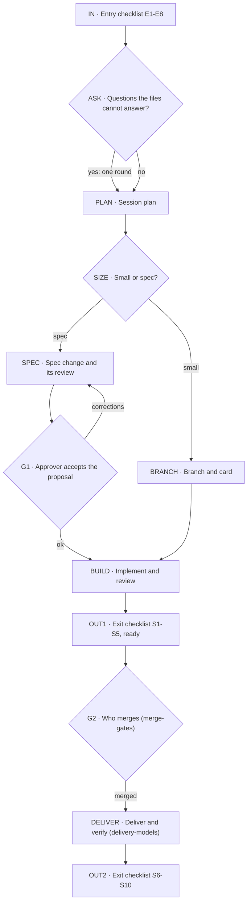

# Change flow

One flow for any change in a repository, whatever it is called. Its state lives in the branch, the spec change (when there is one) and the pull request, so any agent can pick it up. The repository's `AGENTS.md` sets the facts (the lines E2 lists); the user's own instructions fill a missing line; without either, take the strictest reading and say so.

Walk the map in order. A node that does not apply still gets its one-line answer ("n/a: <reason>"). "Done" without every exit item answered is not done.

## Steps

**IN, the entry checklist.** Answer each item from the files first; only a decision, or a fact no file holds, goes to the user.

- **E1** Repository: where does the change belong? For a defect, find the failing code first: the cause may live in another repository. Several repositories: one change each, producer first (CHG-6).
- **E2** Facts from `AGENTS.md`: `Stack:`, `Spec:`, `Delivery:`, `Model:`, `Integration branch:`, `Data:`, `Tracker:`, `Approver:`, the checks and `Deliver and verify:`. A missing line is inferred, named in the plan and added in this change.
- **E3** What changes for whoever uses the code: that gives the size.
- **E4** Card: does one exist on the tracker, and is one required (TRK-1)?
- **E5** Consumers: for a package, which repositories depend on it (they get follow-up pull requests, S8).
- **E6** Gate: which level applies to the merge, any delegation in this session (quote it), and whether the agent can write to the repository (merge-gates, if installed).
- **E7** Skills to load: the specialty of each technology on the `Stack:` line, plus a security review when secrets, identity or permissions change.
- **E8** Open questions: what the files could not answer and would change the result.

**ASK.** With E8 questions, one round: every question at once, numbered, each with a recommended answer. Then wait.

**PLAN.** Write the plan block ([templates](references/templates.md)) and show it; go on unless it has questions. It opens the pull request description.

**SIZE.** Small: a fix, refactor, bump, config, pipeline, documentation or data; nothing a caller must learn changes. Spec: new or changed behaviour (endpoint, business rule, contract, flow). In doubt, small, with the reason in the pull request. A repository with `Spec: none` takes the small path for every change.

**BRANCH.** Branch, card when required (moved to doing), first push, a **draft** pull request with the plan as its description (CHG-1 to CHG-3).

**SPEC.** The spec change in the repository's tool (`Spec:` line): proposal (problem, change, out of scope), requirements with testable scenarios, a design only for a real decision, small tasks naming the scenario and test each proves. Then a spec review by a clean-context reviewer (REV-1). Draft pull request.

**G1.** Show the approver the proposal in ten lines and wait for "ok" or corrections. Skip only on their explicit words, written in the pull request.

**BUILD.** Reproduce a defect first (a command, then a failing test). Implement with tests, run the repository's checks, then the review loop (REV-1 to REV-4). Update the repository's docs in the same branch. Archive the spec change in the same branch after the code review.

**OUT1.** Answer S1 to S5 in the description, then mark ready (CHG-4).

- **S1** Checks: each command and its result; with a spec, each scenario and its test.
- **S2** Review: rounds, findings fixed, findings rejected and why; or "not done" and why.
- **S3** Documentation changed, or "none" and why.
- **S4** Preview: the preview URL or screenshots for a live or staged change, rendered stills for a visual package change; otherwise "n/a".
- **S5** Merge: the level, a delegation (quoted) or the approver.

**G2 and DELIVER.** `merge-gates` and `delivery-models`, if installed; otherwise the approver merges and the `Deliver and verify:` line runs.

**OUT2.** After the merge, post the "After merge" comment ([templates](references/templates.md)).

- **S6** Delivery: what ran and its result; the verification and its result.
- **S7** Records: the card closed; project notes the user's instructions name, updated.
- **S8** Consumers: a follow-up pull request per consumer that only bumps the version, or "none".
- **S9** Cleanup: the worktrees and merged local branches of this change removed.
- **S10** Process: where this flow was missing, wrong or in the way, one line each, or "none".

## Rules

Read [rules.md](rules.md) (CHG, REV, TRK) and follow every rule. The tracker commands are in [references/trackers.md](references/trackers.md). Cite a rule by its ID when you apply or break it.
